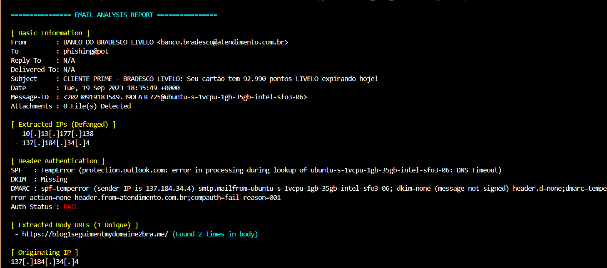
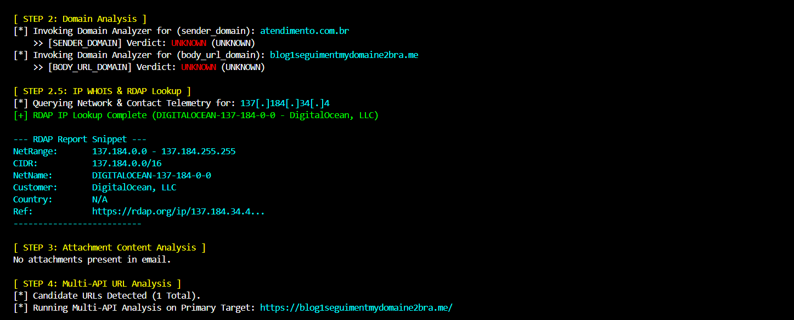
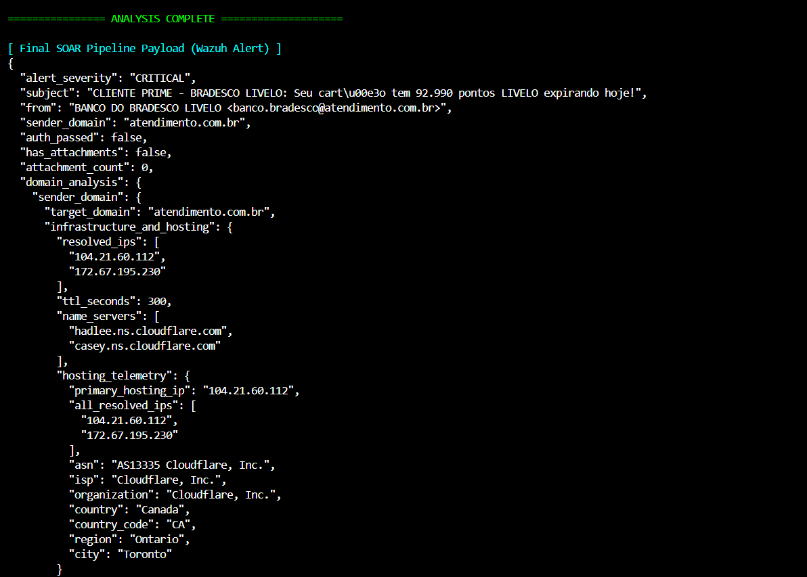
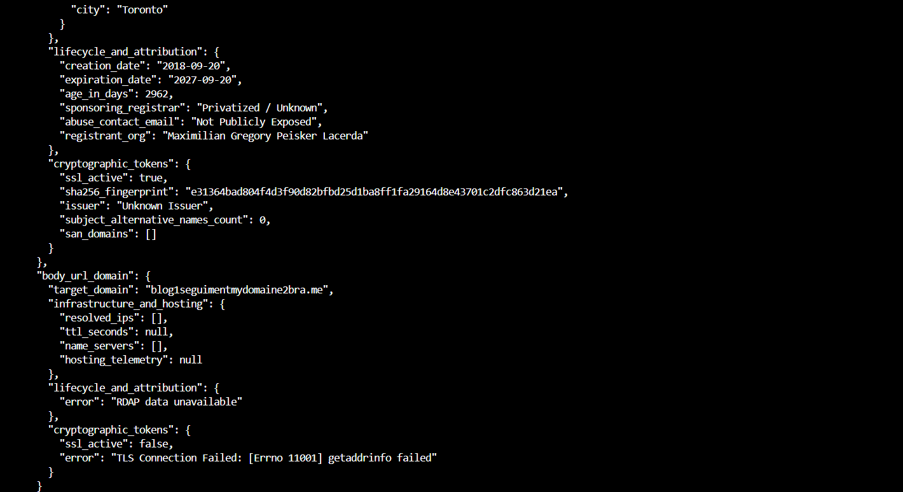
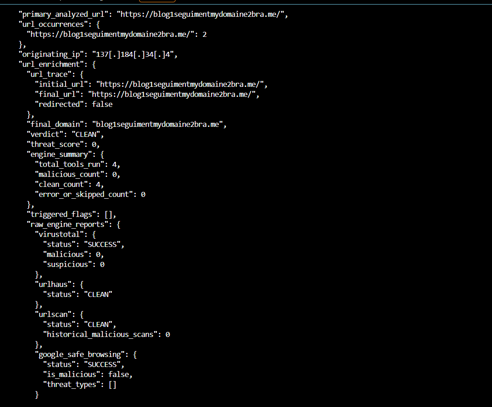
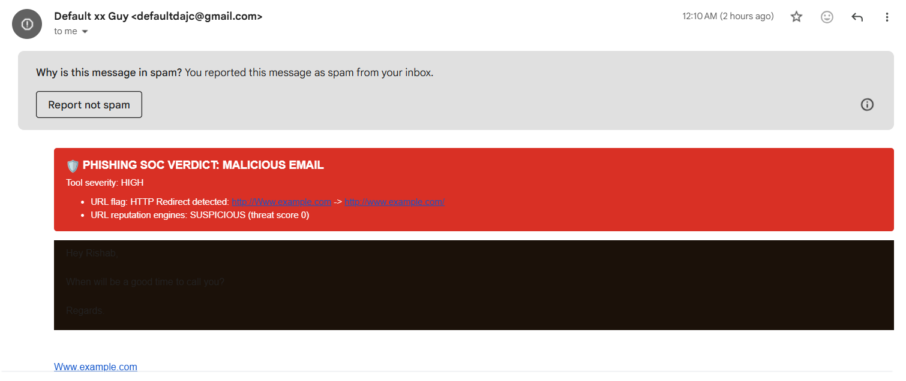

# KingPhisher-Man SOC Lab for Windows

A Windows-focused phishing detection and email analysis lab that simulates phishing email delivery, performs automated email security analysis, and supports SOC-style investigation and response workflows.

## Project Overview

KingPhisher-Man combines `.eml` collection, email analysis, inbox monitoring, and verdict-based email handling into a practical phishing analysis workflow. The project aims to demonstrate how suspicious emails can be analyzed, classified, and handled before they become a user-facing threat.

The lab currently supports two primary workflows:

- **Sample-based analysis:** Select phishing email samples from the Phishing Pot GitHub repository, analyze them, and deliver them to a Gmail inbox for controlled testing.
- **Live inbox monitoring:** Monitor a controlled Gmail inbox for incoming emails from a designated attacker account, analyze received messages, and handle them according to the analysis verdict.

## Current Workflow

```
[ Incoming Personalized Email / .eml Injection ] ➔ ➔ ➔ [ Enters @gmail.com Inbox ]
                                                   │
                                                   ▼ (Triggered Instantly)
                                         [ GMAIL API EVENT LISTENER ]
                                                   │
 ┌─────────────────────────────────────────────────┴─────────────────────────────────────────────────┐
 ▼ (Step 1: Immediate Quarantine Simulation)                                                          ▼ (Step 2: Analysis)
[ Remove 'INBOX' Label ] ➔ [ Apply 'TEMPORARY_HOLD' Label ]                                   [ Download Message Data as .eml String ]
              │
                                                                                                     ▼
                                                                                              [ RUN CODE ANALYSIS CHAIN ]
                                                                                                     │
 ┌───────────────────────────────────────────────────────────────────────────────────────────────────┴──────────────────────────────────┐
 ▼ IF VERDICT = CLEAN (Step 3A)                                                                                                         ▼ IF VERDICT = MALICIOUS (Step 3B)
1. Inject HTML Verdict Banner to Email Body String.                                                                                    1. Apply 'QUARANTINE' / Trash Label.
2. Send updated email copy back to Inbox via SMTP/API.                                                                                 2. Permanently delete/archive the original message.
3. Trash/Delete the original un-analyzed email from 'TEMPORARY_HOLD'.                                                                   3. Alert admin/console of blocked thread.
```


### 1. Email Sample Collection and Delivery

- Selects five random `.eml` samples from the configured GitHub phishing sample source.
- Sends the selected messages to the configured Gmail inbox.
- Preserves the original email content and metadata while adding the configured recipient to BCC for controlled delivery.

### 2. Automated Email Analysis

The email analyzer extracts and evaluates relevant email indicators, including:

- **Header analysis:** Sender, recipient, Reply-To, subject, delivery details, attachments, authentication results, and originating IP information.
- **Domain analysis:** Evaluates domains using configured tools and heuristic rules.
- **URL analysis:** Supports investigation of suspicious links and associated indicators.
- **Attachment analysis:** Performs basic file analysis, including hash collection and reputation checks where configured.
- **IP analysis:** Extracts and examines relevant IP address indicators.

The analysis chain produces a JSON verdict containing correlated findings and scoring information. The output is intended to support downstream alerting and investigation.







### 3. Controlled Inbox Monitoring and Email Handling

The lab monitors a controlled Gmail inbox for new messages from a designated attacker account.

When a message is detected:

1. The message is temporarily removed from the inbox view and placed under a temporary hold label.
2. The message is downloaded and passed through the email analysis chain.
3. A verdict banner is added to the email copy.
4. The message is handled according to the verdict:
   - **Clean:** The updated message is returned to the inbox and the original is removed from temporary hold.
   - **Malicious:** The message is quarantined or moved to trash, and an administrative alert is generated.

The controlled attacker workflow currently uses a limited monitoring window to avoid indefinite polling.



## Current Version

**Version:** 1.1  
**Status:** Active development

Version 1.1 strengthens the domain analysis component with additional heuristic behavior and correlation rules to improve verdict quality and reduce noisy findings.

The core sample-delivery and email-analysis workflows from Version 1.0 remain part of the project.

## Known Limitations and Planned Work

- Wazuh dashboard integration of the JSON verdict is not yet fully tested.
- Attachment analysis currently covers basic analysis; deeper sandbox-based behavioral analysis remains future work.
- Domain, URL, and IP analysis may be expanded as additional correlation rules and enrichment sources are implemented.
- Inbox monitoring and email handling may be further refined as the lab evolves.

## Repository Structure

The project contains separate components for:

- `.eml` sample collection and delivery
- Email header and indicator extraction
- Domain, URL, attachment, and IP analysis
- Controlled inbox monitoring and verdict-based handling
- Supporting documentation and analysis sub-tools

Refer to the relevant component directories for implementation details and configuration instructions.

