# Dragos CTF Challenege - 2026

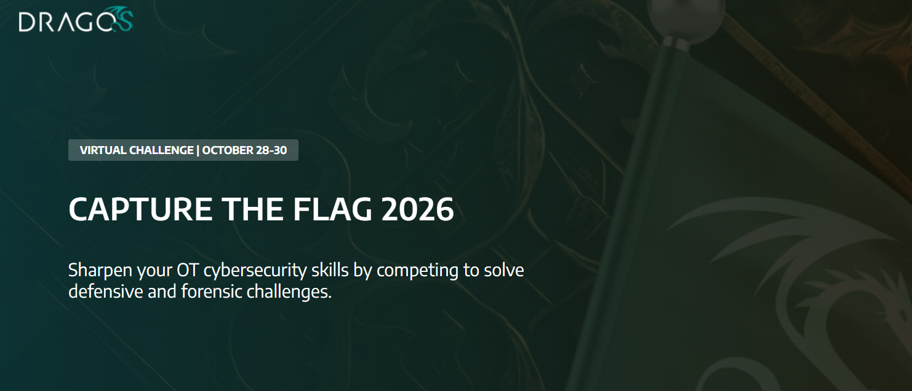

## Information about the CTF

As per the rules, I cannot create the walkthrough of how I found the flag, hence I will find the flag and directly give basic hints and nothing much as these flags will be reused. I will just write the final location of the flag without making it much obvious.

### Discord Acknoledgement 200

**Scenario Description**

Welcome to the Dragos 2026 CTF!

Please head over to our Discord Server, accept the Rules & Regulations, and find the hidden flag in one of the channel's description.

Good luck, but most importantly, have fun!

Flag Format: flag{flaghere}

Answer: Flag Discovered

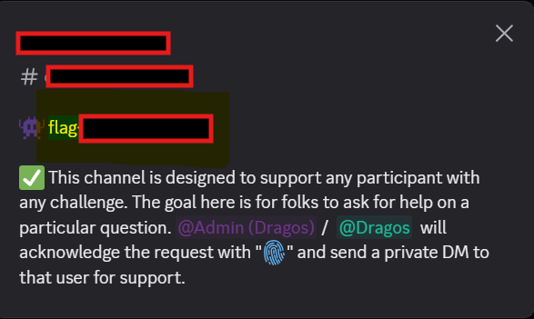

### General Trivia 

**Type:** OSINT

**Scenario Description:**

**Question:** Dragos tracked three new industrial threat groups in 2025. Which threat group is known to target victims in the water vertical?

This is a public faced content hence the answer can be provided.

**Answer:**  Check from google about the Dragos and their new industrial threat groups.

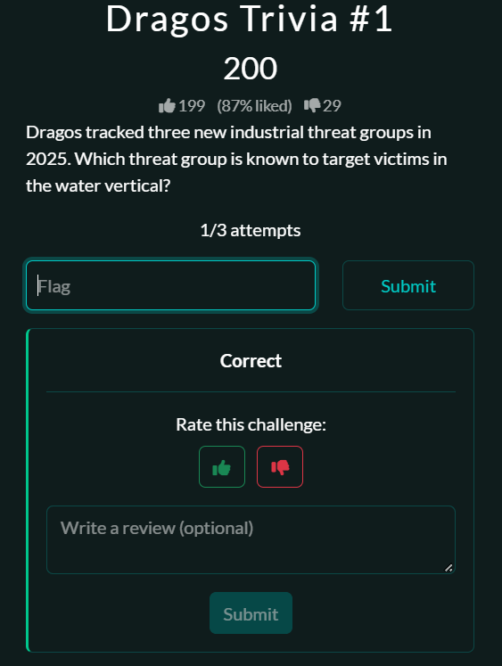

**Question:** What type of assets does SYLVANITE target when supporting Stage 1 of the attack kill chain?

a. IT/OT Perimeter Firewalls 
b. Engineering Workstations 
c. Internet-Facing Devices 
d. IT/OT Dual-Homed Machines

**Answer:** Research more about the Threat Group to gain the answer.

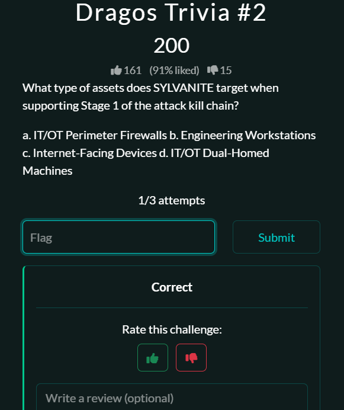

**Question:** In the Oldsmar attack scenario, what security weakness most directly enabled the misuse of the remote access application?

a. Lack of antivirus software on the workstation 
b. Outdated SCADA firmware vulnerability 
c. Insufficient controls around remote access 
d. A zero-day exploit in the remote access software itself

**Answer:** You have to read through the attack carefuly or just use simple google search techniques and get the answer.

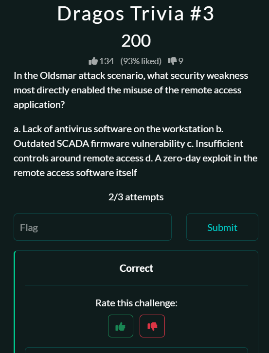

**Question:** What tool did Dragos release this summer that could answer the key ICS question, What If Every Cybersecurity Analyst Had Ten Years of xOT Experience?

**Answer:** Amazing tool, I mean learning about this industry and the future in this is a good go to thing that can be useful.

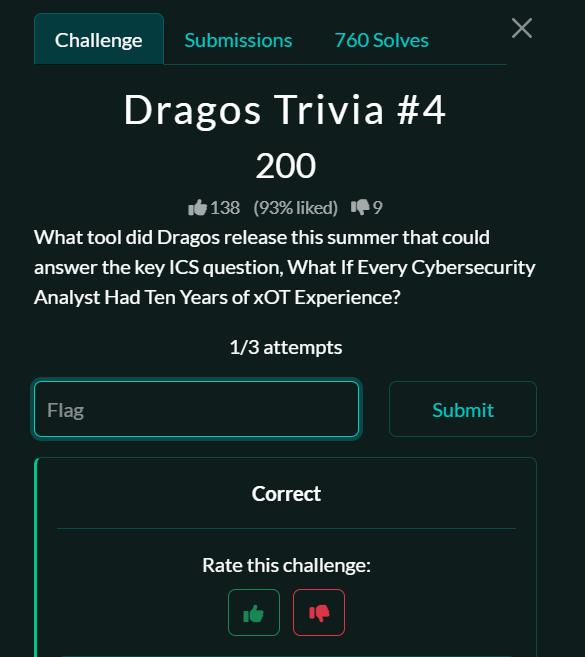

### Initial Access and Lateral Movement

Now the real fun begins!

**Tools used for the use case:** Wireshark 

#### Scenario 1: Try and Try Again
A small Florida water utility that provides clean potable water for a number of communities near Orlando has been dealing with inaccurate internal readings, and an internal investigation has been initiated.

The response team split into two teams, one focused on internal communications, while the other tried to identify possible external threats. The external team reviewed the logs from the public-facing firewall and noticed a whole bunch of HTTP brute-force attempts targeting an internal Engineering Workstation. They were able to obtain the attached PCAP file. Review the PCAP file and answer the following questions...

**Question-1:** What challenge-response mechanism is configured on the Engineering Workstation?

**Attachment:** TryAgain-TargetAcquired.pcap

**Flag Format:** Two Words, seperated by a space

Pcap File Preview: 

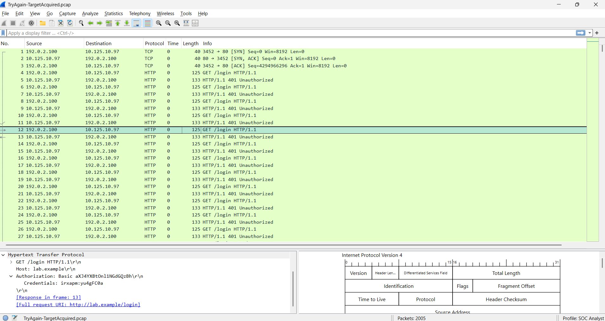

**Answer:** Analyze the pcap properly

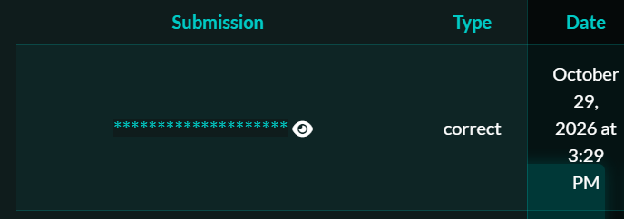

**Question-2:** What is the hostname?

**Answer:** Host: {Flag}

If you opened the HTTP packets follow the stream you will be able to see the hostname

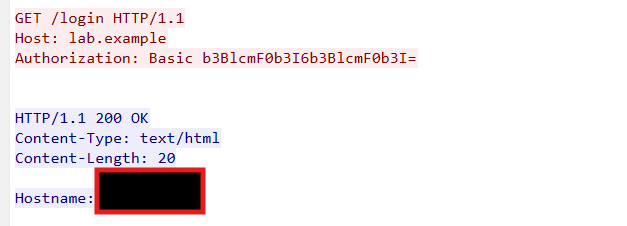

#### Scenario 2: Call the Movers

The response team is on a mission! They're working through internal and external logs - trying to track down the suspected external threat. The response team knows the attacker came in via a brute-force attack against an internal Engineering Workstation that was directly connected to the internet over HTTP.

Now it appears that the attacker has leveraged some known tools to enhance their attack foothold. The response team needs to track down where they went - or where they're hiding...

It looks like the threat scanned internal hosts to identify key, remote code execution ports. Using this information and the attached PCAP, 

**Question-3:** Can you identify what non-default network share the threat found and leveraged in their attack?

**Attachment:** Callthemovers.pcap

**Answer:** The attack does seem like an NMAP Attack. It is just time to notice the exposed port

Pcap Preview for NMAP Scan:

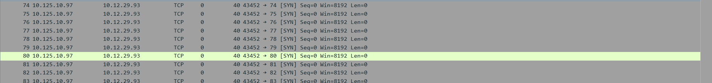

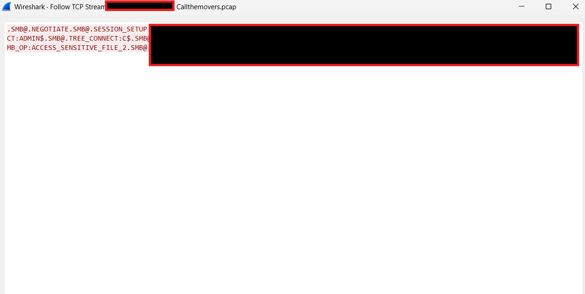

#### Scenario 3: Working from Home

**Scenario Description:** 

Remote access provides organizations with a lot of administrative flexibility, but it can come at a cost...

Before COVID, most organizations had decent remote access procedures in place, but as the "work from home" mandate grew, remote access became an area of focus for both network administrators and threat actors. Some organizations allowed connections from the internet, directly to an OT workstation, while others leveraged MFA and network segmentation to secure their OT crown jewels.

Can you sort through the attached PCAP and identify the username associated with the SCADA server (the victim)?

**Answer:** Well this was tricky after multiple tries I got the right answer. I believe it is just about the formating you have to stick to what is given.

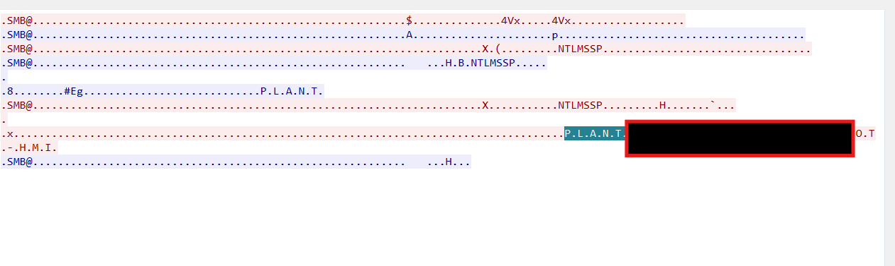

### Priveledge Escaltion & Persistence

**This part of challenge involves using Digital Forensic Tools:** Windows Registry Explorer, Cyberchef

#### What's Simple About This?

**Scenario Description:**

The responders have been working their way through Windows forensics when they stumbled across some system files that might help them know which user account was compromised and leveraged for the attack. There's more than one user, let's pick the right data!

**Question:** Can you identify the NTLM hash associated with a null (empty string) password in Windows systems?

**Answer:** Registry Analysis using registry explorer.

Well this takes some understanding about registry, and what exactly you need to find.

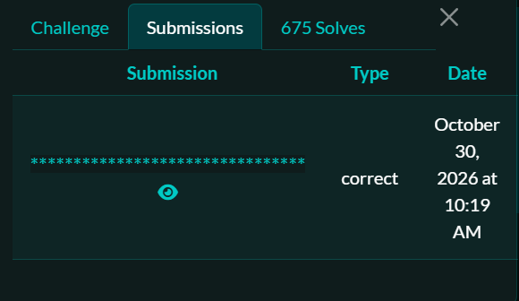

**Learnings from above Question, Tool and Windows Registry**

First we need to understand the underlying cryptographic architecture of Windows and use a systematic derivation process.

1. The Idea or Reason behind the hashing algorithm

Windows does not store passwords in plaintext; it stores them as mathematical hashes using the NTLM (NT LAN Manager) protocol.

1. Deterministic Hashing: The NTLM algorithm is purely deterministic. This means that the exact same input string will always produce the exact same output hash value, regardless of the computer or user account.
2. The "Null" Signature: Because an empty string (zero characters) is a fixed input, its resulting NTLM hash is a well-known, static 32-character hexadecimal signature globally recognized in digital forensics.
3. The Clue in the SAM: If an attacker cleared a password or exploited an account created without one, that account's NTLM slot inside the SAM hive will match this specific static signature perfectly.

Before we hunt we must know what to look for:

>**Note:** The NTLM hash is calculated by taking the input string, converting it to Little-Endian UTF-16 (Unicode), and then running it through the MD4 hashing algorithm.

This gives us enough hint what to do. 

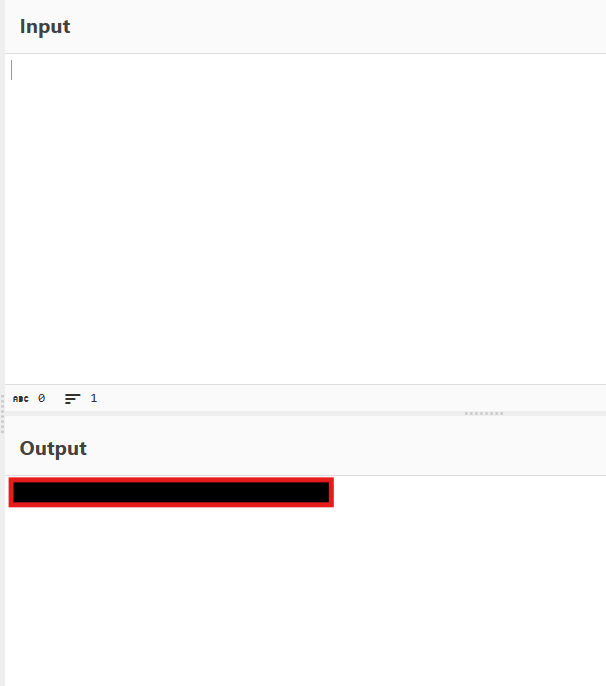

#### So Many Options

**Scenario:** The responders didn't just collect blank hashes when they pulled the system files; they were able to collect some legitimate hashes...

**Question** Can you identify the cleartext password for the "operator01" user account? We think this is how the adversaries carried out phase 2 of their attack against the water treatment facility.?

**Answer:** 

This is going to be the reverse process. We have to find the clear text password for the hash generated for Operator01.

Reverse Hash is not possible? So the next best thing to do? 

Lets search for Operator01 and try to find the hash we have. Since that was the point of exploitation 

We have to use Mimikartz for this:

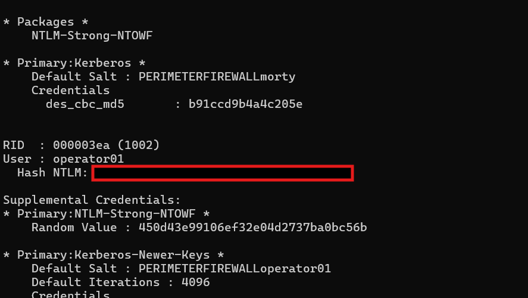

And Voila we get the correct answer

Submission	Type	Date
******** 	correct	October 30, 2026 at 11:20 AM

**Learnings from above Question, Tool and Windows Registry**

Things displayed in GUI is not always what is always supposed to be true, every value and every other information out there has a meaning. To find the right tool, to knowing how to use is important and this is where

#### Please Schedule an Appointment

**Tool Used:** VSCode

**Scenario:** 

Early the next morning, the responders noticed a new alert: an engineering workstation on the OT network (ENG-WS-04) made an outbound HTTP POST to an undocumented, internal IP address on the Process Control Network. The connection lasted three seconds and occurred at 03:17 AM. By the time the responder connected to the machine, the process was gone.

The responder collected a triage package from ENG-WS-04 before it was isolated. The package includes:

- A full export of all registered scheduled tasks
- A snapshot of the user profile's AppData\Roaming directory

**Question** Can you search through the attachments and identify the IP Address where the outbound HTTP POST connection was established?

**Answer:** 

We have to find when the system process changes took place from the files hence: 

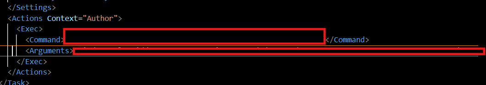

#### Who's Cutting Onions

**Scenario:** Nothing is easy, is it? First, we found the internal IP Address that the threat group was using to exfil data, which is a great find, but there's more...

The decoded data didn't just reveal a new internal IP address; it also provided the response team with some key information about some local data.

**Question:** Can you use the decoded data to help find the key that the threat group left behind?

**Answer** Solving the previous question helped get the flag

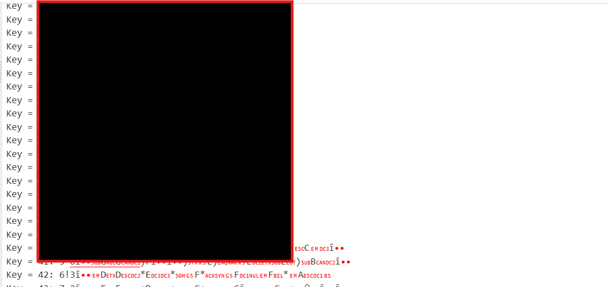

### Collection

**Scenario:** 
Over the past 18 months, critical water and wastewater treatment facilities have become prime targets for state-sponsored threat groups and criminal ransomware operations. A series of coordinated attacks across North America and Europe has left utilities scrambling to secure their operational technology networks. Last spring, a regional water authority in Pennsylvania discovered unauthorized access to its SCADA system. The attackers had implanted firmware in their treatment process controllers — potentially allowing them to manipulate chemical dosing or bypass safety controls. The attack was traced to a compromised monitoring vendor used by utilities across three states. Your friend oversees operations at a mid-sized water treatment facility in the Midwest. Following the industry alert, they implemented enhanced monitoring on all critical systems. They hoped it was enough. At 3:47 AM on Tuesday, January 15th, their automated security system triggered a critical alert:

CRITICAL: Siemens S7-1200 PLC (Production Line #1) - FIRMWARE HASH MISMATCH Expected Hash:  e3b0c44298fc1c149afbf4c8996fb92427ae41e4649b934ca495991b7852b855 Detected Hash:  a1f2c89d7e3b4f5c6d8e9f0a1b2c3d4e5f6a7b8c9d0e1f2a3b4c5d6e7f8a9b Last Update:    2024-01-15 03:25:40 AM Status: CRITICAL

The primary treatment system went offline. Water quality monitoring is now manual. Emergency protocols are active. Your friend called you in to determine if this is the same attack vector hitting other utilities — and how deep the compromise goes.

**Your Task:** Analyze the rough sketch of the network diagram provided by your friend and the CVE descriptions below to reconstruct the complete attack chain.

**Question:** Which port allowed the attacker to compromise the first device in the chain?

**Answer:** Check and refer the CVE Carefully

**Question:** What is the IP address of the second device in the attack chain?

**Answer:** The diagram reveals it all

**Question:** What CVE allowed the third device in the attack chain to be compromised?

**Answer:** SED....

WELLL TRYING TO SOLVE THE NEXT CHALLENGE AND BOOM THIS IS WHERE I LAND!!!! 

I was a day late but I solved too many question and did end up learning a lot though.

