# Splunk - Exploring SPL & Mini Challenges

Splunk is a powerful **Security Information and Event Management (SIEM)** platform that allows analysts to search, visualize, and investigate log data. Its Search Processing Language (SPL) is the key to turning large volumes of data into practical results. 

## Motive of the Challenge

In this room, you will explore SPL, learning how to build, filter, and transform search queries to extract meaningful information.

## Searching & Reporting

We are going to be dealing with windows logs for this particular exercise

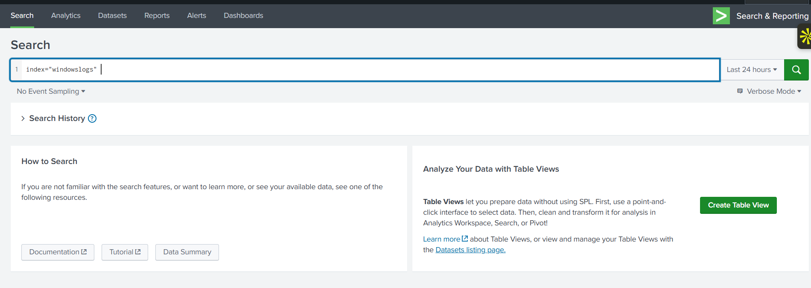

AFter pressing enter we get:

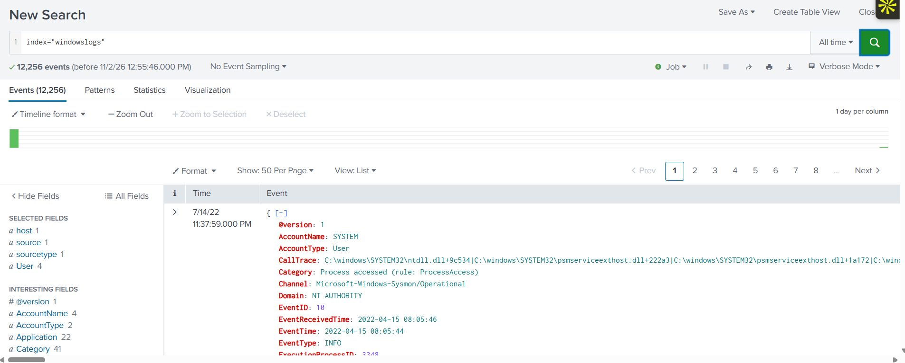

### Challenge Question

**Question:** Submit your first query for All Time: index=windowslogs.
How many total events do you see?

**Answer:** 12256

**Question:** After you submit your first query, look in the Fields sidebar.
Which SourceIP has recorded the most amount of events?

**Answer:** 172.90.12.11

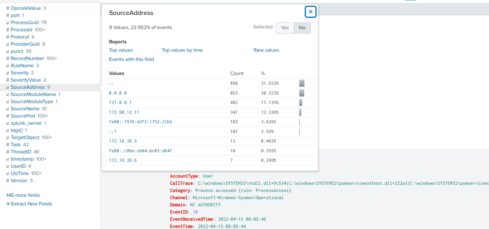

Now the main question is why it is this and what about the other parameters that occured in the Source Address field?

> 172.90.12.11 is a Routable IPv4 Address: This is considered a "proper" source/destination address, WHILE 127.0.0.1 and ::1 are Loopback Addresses: These represent the local host itself.

**Question:** How many events appear on 04/15/2022 from 08:05 AM to 08:06 AM?

**Answer** 134

Lets set up the time and date from the filter given: 

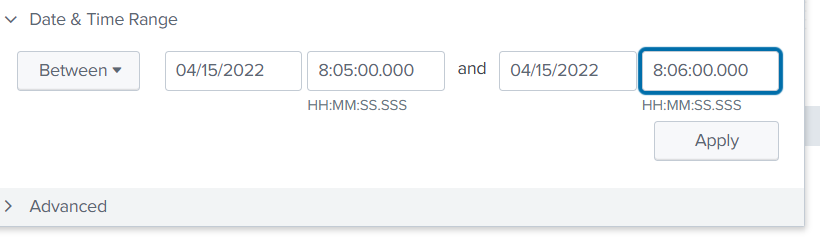


## Search Operations

Splunk's Search Processing Language (SPL) is behind every search in Splunk. It combines commands, functions, and operators that allow you to filter, transform, and analyze data from your ingested logs. In essence, SPL lets you search through massive amounts of data, apply filters to narrow down results, and format the output. Let's see how to use SPL.

Eaxmple useage: index=windowslogs alice

> **Search Relational Operators:** =, && , != , > , >= , < , <= 

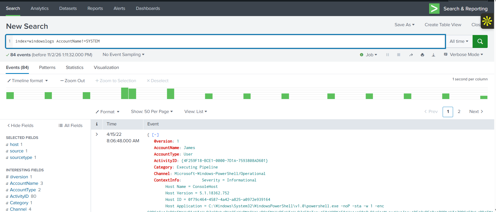

> **Search Logical Operators:** AND, OR, NOT, IN

**Wildcard and CIDR Searches:**

- (\*) can be used as : status = fail* or *fail or (best of both worlds: \*fail\*)

This will return: This will return all events that have status field set to failed, failure, appfail, etc.

- (\*) can be used as: DestinationIp=172.* 

This will return: This will return all events that contain values like DestinationIp=172.90.0.0.1 or DestinationIp=172.18.5.22

- N/A: DestinationIp=172.18.0.0/16 

This will return all events where DestinationIp field is within the 172.18.0.0/16 subne

### Challenge for Topic

**Question:** How many events in the windowslogs index have an EventID field value equal to 4624?

**Answer:** 26

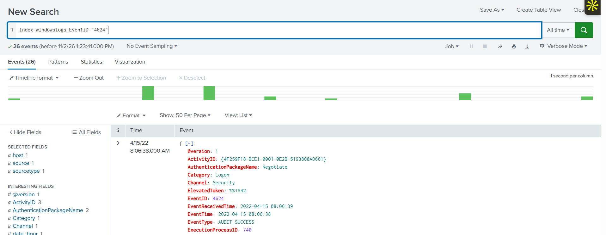

**Question:** How many events are observed with the DestinationIp = 172.18.39.6 and DestinationPort = 135?

**Answer:** 4

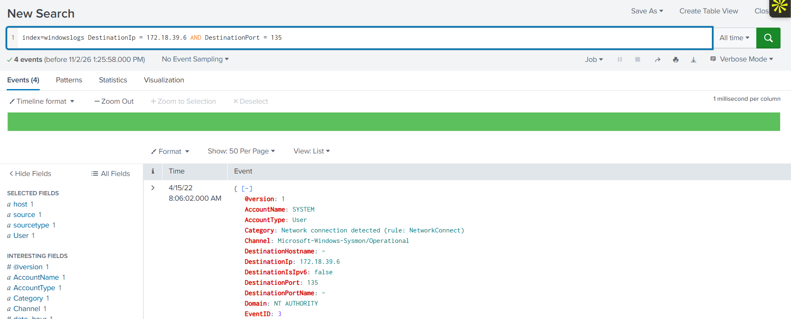

**Question:** Use the query index=windowslogs Hostname=Salena.Adam DestinationIp=172.18.38.5
Which SourceIp returns the highest count?

**Answer:** 172.90.12.11

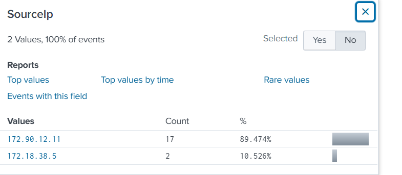


**Question:** How many events are returned when you search the term cyber*?

**Answer:** 12256

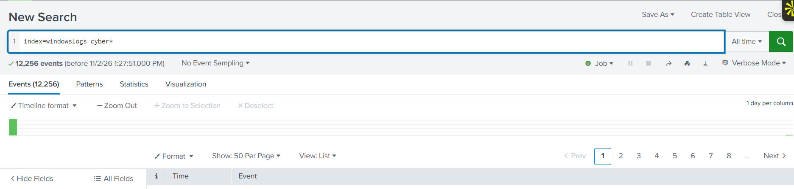

**Question:** Which operator is given the lowest priority in Splunk searches?

**Answer** AND

## Filtering Results

We can filter by these options:

1. Usefull Fields
2. Dedup
3. Rename
4. Regex


```
1. index=windowslogs | fields host User SourceIp
2. index=windowslogs
| fields EventID User Image Hostname SourceIp
| dedup SourceIp

3. index = windowslogs
| fields EventID User Image Hostname SourceIp
| rename User as Employee

4. index = windowslogs | regex Image = "\.exe$"
```
### Challenge for the topic

**Question:** Use the fields command to highlight Domain, SourceProcessId, and TargetProcessId.
Which SourceProcessId has the highest value?

**Answer:** 9496

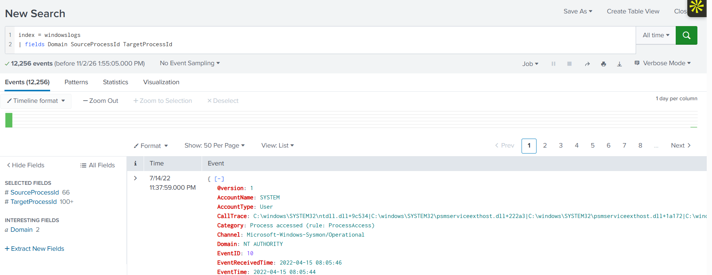

**Question:** Try out this query index=windowslogs | regex TargetObject="Manager$".
Which TargetObject field value contains the highest number of results?

**Answer:** HKLM\SOFTWARE\Microsoft\SecurityManager

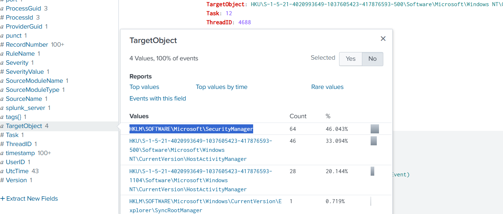

## Structuring Results

The Search Processing Language (SPL) provides further commands that help organize and structure your search results. When working with log data, raw search results can be overwhelming, and some events may contain fields that may not be relevant to your investigation. SPL commands enable you to filter, order, and format these results, allowing you to focus on the most important information. 

### Challenges for the Topic

**Question:** Build a table that highlights the EventID, AccountName, and AccountType fields.
Which AccountName appears first in your results?

**Answer:** SYSTEM

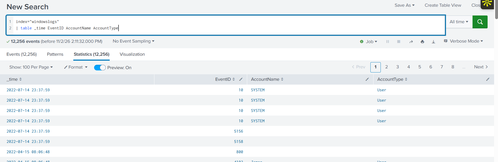

**Question:** Append the above query to include the reverse command. Which EventID appears first?

**Answer:** 800

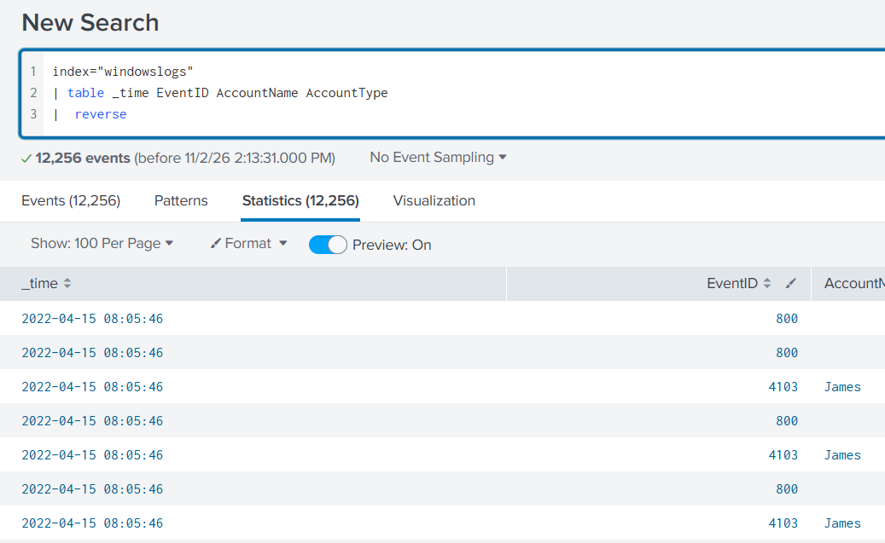

**Question:** Use the query below to build a timeline of events.
What password was given to the user A1berto?

```
index=windowslogs EventID=1
| table _time ParentProcessId ProcessId ParentCommandLine CommandLine
| reverse
```

**Answer:** paw0rd1

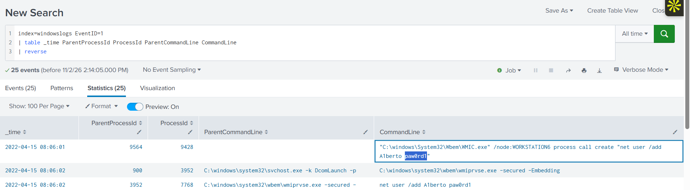

## Transforming Commands

Transforming commands allow you to change raw event data into useful summaries, statistics, and visualizations. Instead of viewing every individual log, they help analysts aggregate, count, and analyze patterns across many events. Searches that utilize transforming commands are referred to as transforming searches in Splunk.

### Challenge of This Topic

**Question** Use the top command to query the Image field.
Which Image field value has the most occurrences?

**Answer:** C:\windows\system32\svchost.exe

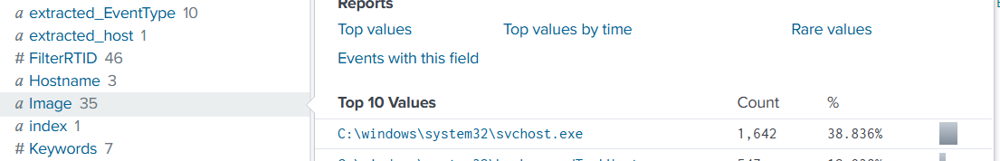

**Question:** Try out the iplocation command with the SourceIp field. Which Region do the IP addresses in your events originate from?

**Answer:** California

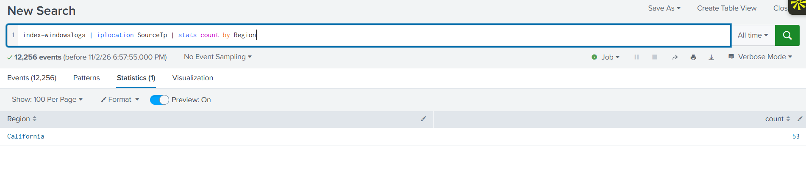

**Question:** Try out this lookup query. Which Image field value has the highest RiskScore?

```
index=windowslogs
| lookup image_riskscore Image OUTPUT RiskScore
| stats count by Image RiskScore
| sort - RiskScore
```

**Answer:** C:\Windows\System32\WindowsPowerShell\v1.0\powershell.exe

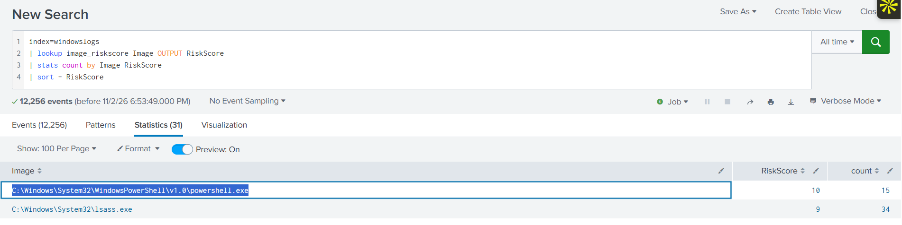

## Anomalies Detection

Sometimes you might investigate a data set with lots of different events (e.g., VPN logins) and will need to quickly identify outliers, the events that look suspicious compared to the others. For example, imagine a data set of 2,000 VPN logins with just four fields: time of the login, username, source IP, and source country. How would you identify logins from unexpected countries, if field statistics don't show any anomalies?

### Challenge of Topic


**Question:** Run the first anomaly detection query (index=vpnlogs). Which other user is marked as an outlier?

**Answer:** JSMITH

**Question:** Which country is anomalous for the user from Q1? Answer Example: CN

**Answer:** JP

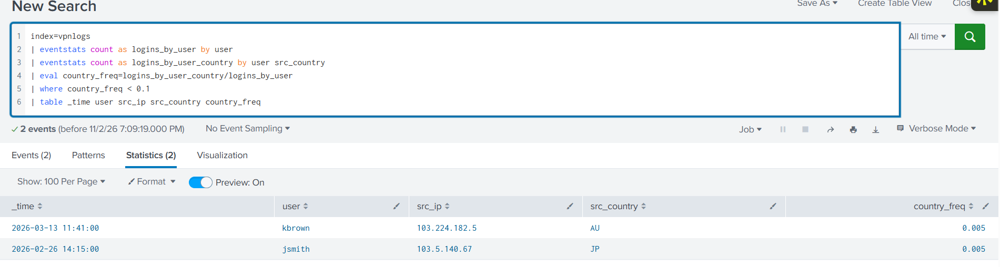

**Question:** Which user logged in suspiciously at 3am?

**Answer:** njackson

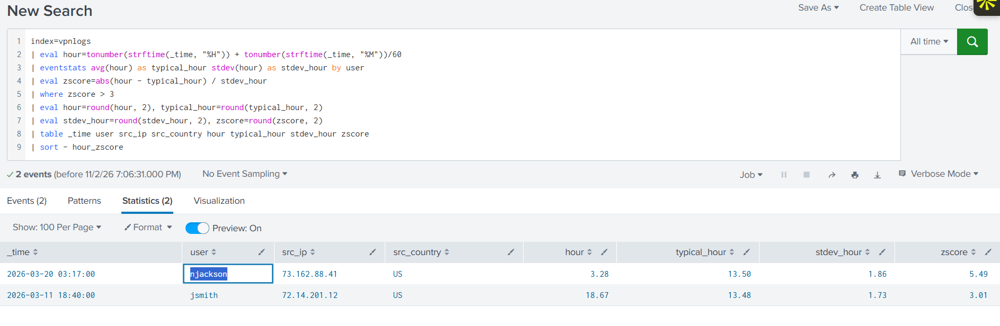


## Learnings and Takeways

Well the topic and creation of SPL is easy but as you dig deeper and try to create deep SPL rules to detect anomalies or any other parameter you endup realizing that you have a lot to understand if you break things down properly. 