# Summit - PicoSecure Internal Team Summit

Can you chase a simulated adversary up the Pyramid of Pain until they finally back down?

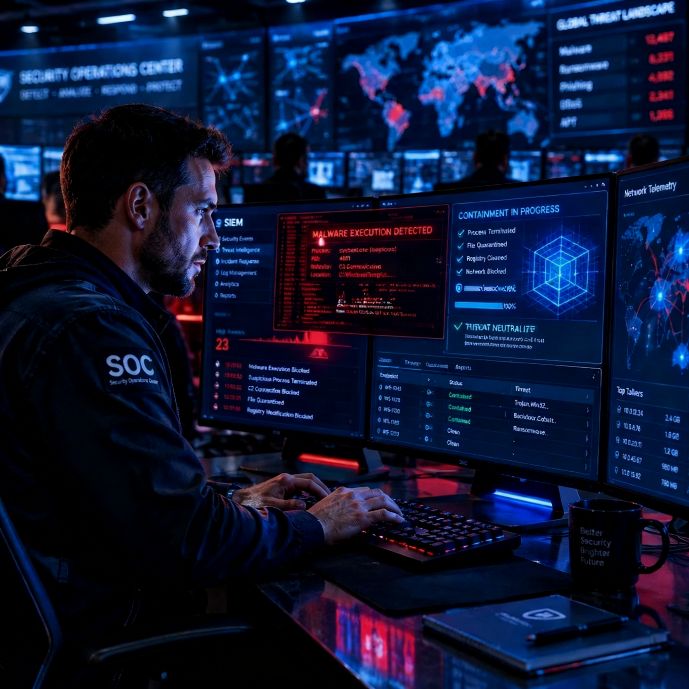

## Objective

After participating in one too many incident response activities, PicoSecure has decided to conduct a threat simulation and detection engineering engagement to bolster its malware detection capabilities. You have been assigned to work with an external penetration tester in an iterative purple-team scenario. The tester will be attempting to execute malware samples on a simulated internal user workstation. At the same time, you will need to configure PicoSecure's security tools to detect and prevent the malware from executing.

## Room Scenario Working

Following the Pyramid of Pain's ascending priority of indicators, your objective is to increase the simulated adversaries' cost of operations and chase them away for good. Each level of the pyramid allows you to detect and prevent various indicators of attack.

Follow this diagram to ensure your enviornment is secure: 

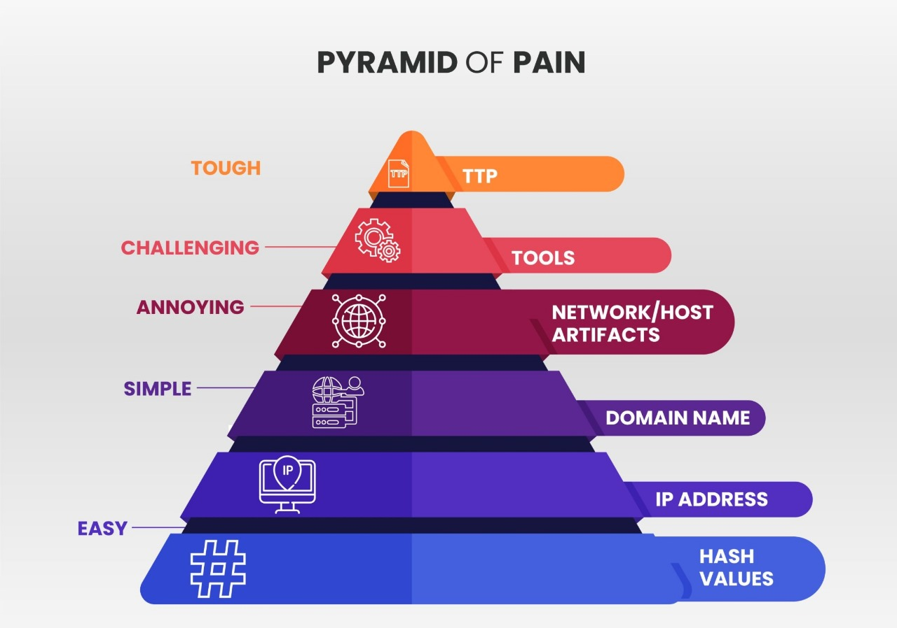

### Challenge 1: The Simple Malacious File 

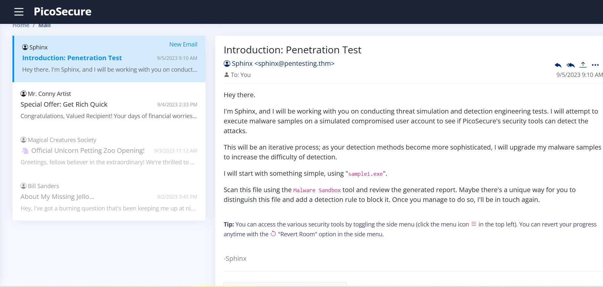 

**Indicator of Compromise (IOC):**
Sample1.exe

We will go to the malware sandbox in the case given which is the hamburger. 

We upload the sample1.exe file in the sandbox for analysis - 

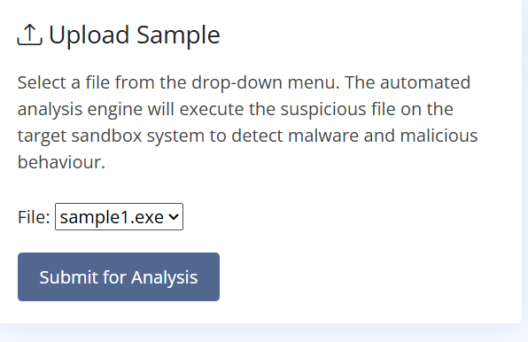

After the analysis takes place: 

We get crucial information that determines positive IOA from these artificats: 

- **General Info** : sample1.exe
- **File Name:** : sample1.exe
- **File Size:** : 202.50 KB
- **File Type** : PE32+ executable (GUI) x86-64, for MS Windows
- **Analysis Date** : 	September 5, 2023
- **OS** :	Windows 10x64 v1803
- **Tags** :	Trojan.Metasploit.A
- **MIME** :	application/x-dosexec
- MD5 : cbda8ae000aa9cbe7c8b982bae006c2a
- SHA1 :	83d2791ca93e58688598485aa62597c0ebbf7610
- SHA256 : 9c550591a25c6228cb7d74d970d133d75c961ffed2ef7180144859cc09efca8c

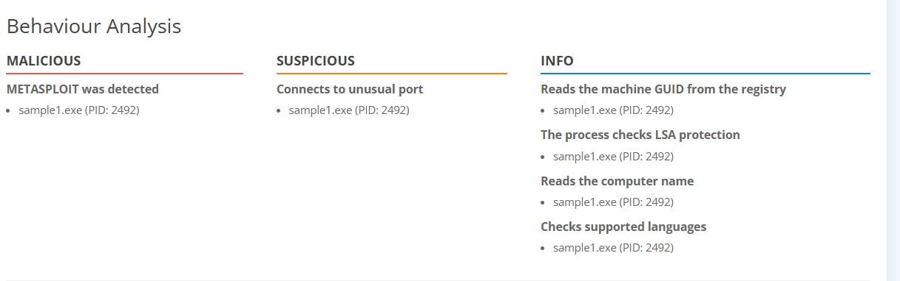

We are able to determine the behavior is malacious so its time we actually flag this as a file that has to be qurantined. 

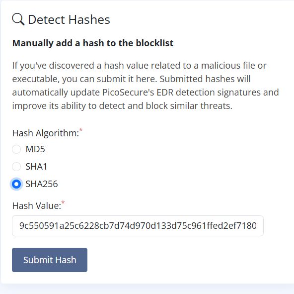

Once we submit the file, then.....

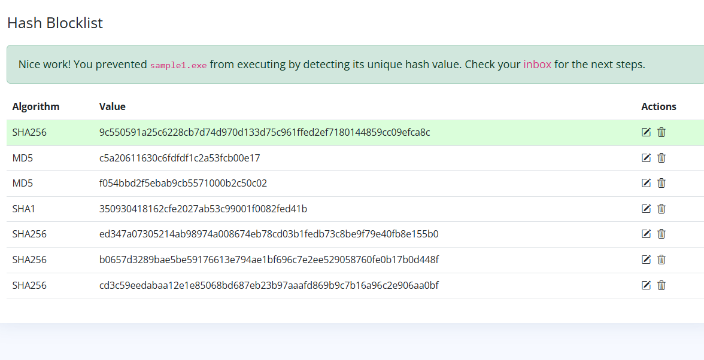
Now we will get the flag from the inbox

**Flag1:** THM{f3cbf08151a11a6a331db9c6cf5f4fe4}

But looks like the red team won't stand down and so wont' we...

### Challenge 2: 

**Note from Red Team to Blue Team:** 

<i>"That detection you added blocked my malware from executing. Since file hashes and digests are unique to each file, they are, by far, the highest confidence indicators out there. You can be sure it's my malware sample the next time you see that hash.

However, by design, that is also one of the significant downfalls of simply relying on hashes for detection mechanisms. Since they are so susceptible to change, I only need to alter a single bit of the file, and the detection rule you added will fail."</i>

**Indicator of Compromise (IOC):** sample2.exe 

A new malware detected means things becomes a lot more different. 

Lets upload the sample2.exe file in malware box and wait for the new results: 

We are able to see that new hash is formed for the same file, that means infinite hashes for infinite modification of a simple file? Tideous
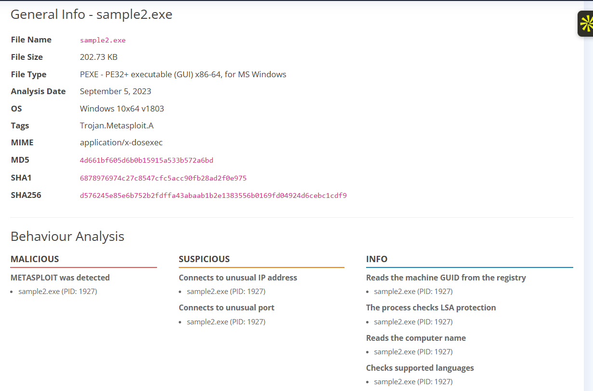

Lets look down: 

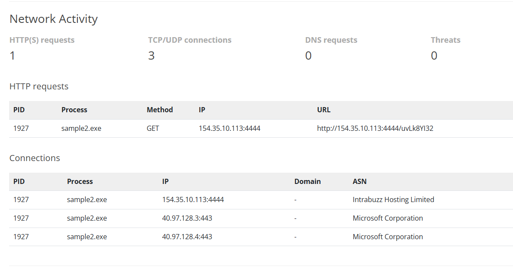

Now this is all about the network connection the file would possibly be able to execute 

**New Artifacts:**
- http request:     http://154.35.10.113:4444/uvLk8YI32
- IP Addresses: 	154.35.10.113:4444 (Suspicious Metasploit Port)

Lets be obvious and go and block the particular attack in a way that this ip address is inbound and outbound connections are banned. 

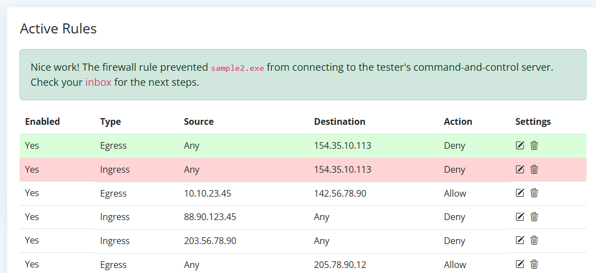

We blocked the IP address, to form an outbound connection to the destination IP we found. 

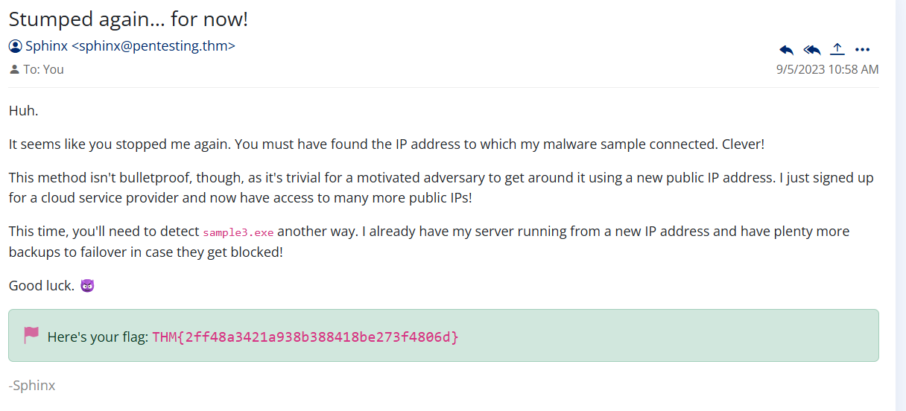

**Flag 2:**  THM{2ff48a3421a938b388418be273f4806d}

### Challenge 3: Stumped! But not yet

**Note from Red Team to Blue Team:** 

<i>This method isn't bulletproof, though, as it's trivial for a motivated adversary to get around it using a new public IP address. I just signed up for a cloud service provider and now have access to many more public IPs!

This time, you'll need to detect sample3.exe another way. I already have my server running from a new IP address and have plenty more backups to failover in case they get blocked!</i>

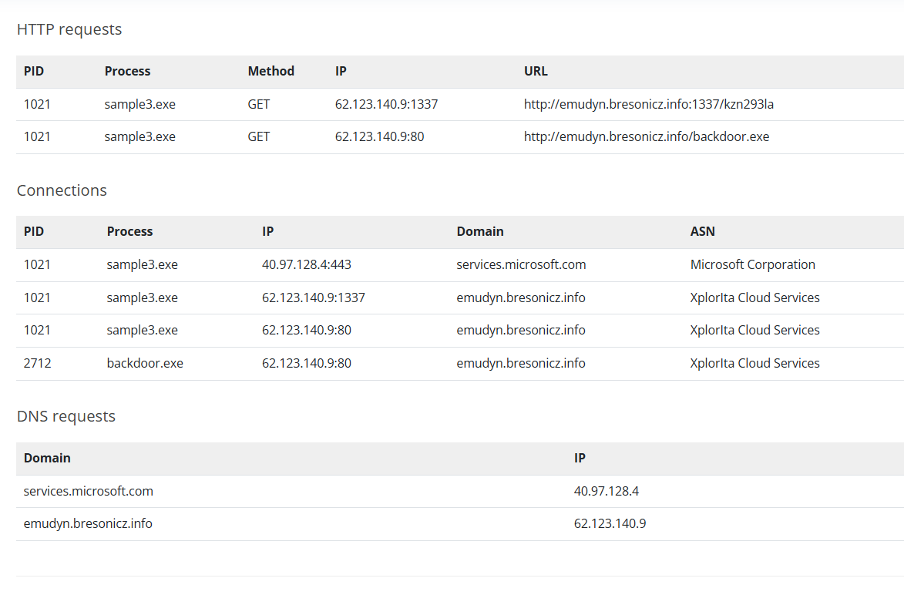

**IOC:** Sample3.exe 

Alright so we have more ip addresses but we also have this time domains present over here, with suspicious process and an unreliable IP. 

So lets target the domain this time, domains are even more harder to purchase and expensive hehee. 

**Artifacts:** 
sample3.exe : 	GET	62.123.140.9:1337 :	http://emudyn.bresonicz.info:1337/kzn293la

sample3.exe : 	GET	62.123.140.9:80 : 	http://emudyn.bresonicz.info/backdoor.exe

Now we will create a DNS filter towards this domain:

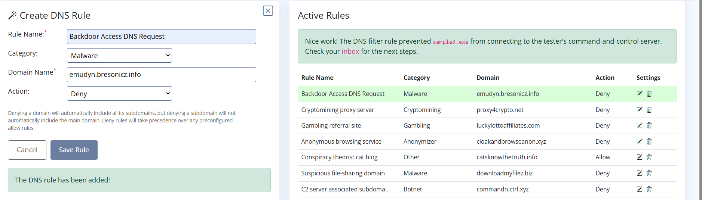

**Flag 3:** THM{4eca9e2f61a19ecd5df34c788e7dce16}

### Challenge 4: 

**Note from Red Team to Blue Team:** 
<i>You're causing me a bit of trouble now because I have to purchase and register some new domain names and modify DNS records. Some attackers might get mildly annoyed by this and find a new target, but I'm motivated to continue like many.

This time - blocking hashes, IPs, or domains won't help you. If you want to detect sample4.exe, consider **what artifacts (or changes) my malware leaves** on the victim's host system.
</i>

**IOC**: Sample4.exe file

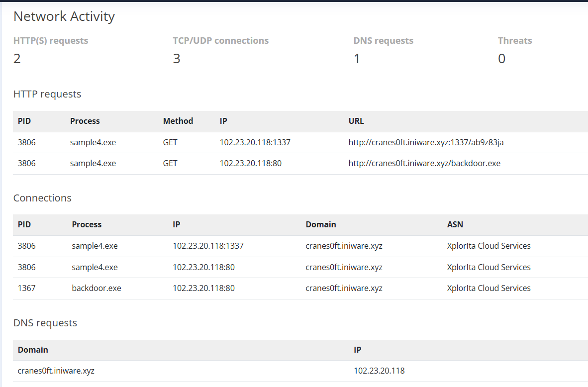

As we are able to notice, more DNS Domain records, more IP addresses, more hashes, and....

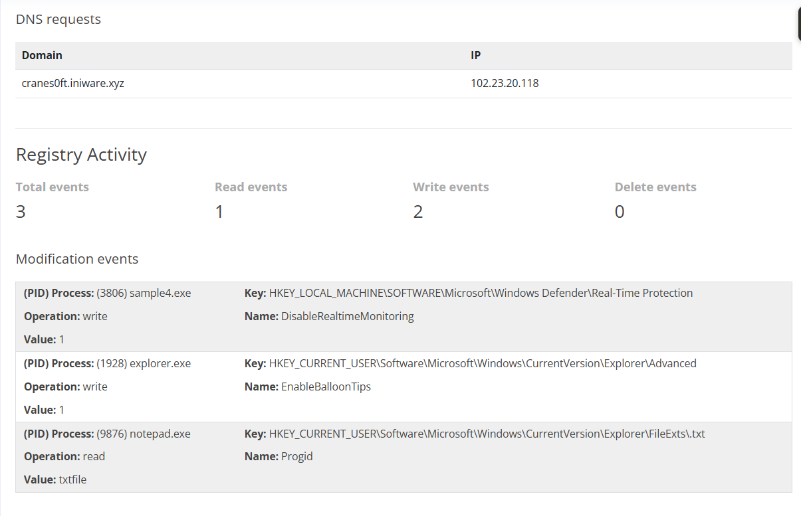

This time, registry key activity. 

These activity means changes taking place on the system, so lets go and create sigma rules as they will help to generate more amount of detection capabilities based on the process and registry key changes made to the device. 

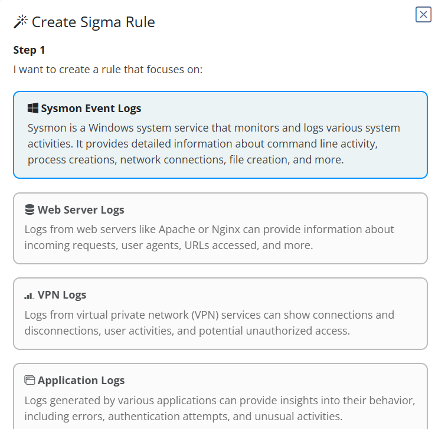

Now since we can see that in the Registry activity we notice registry modification mentioned we choose the last option via sysmon detects it. 

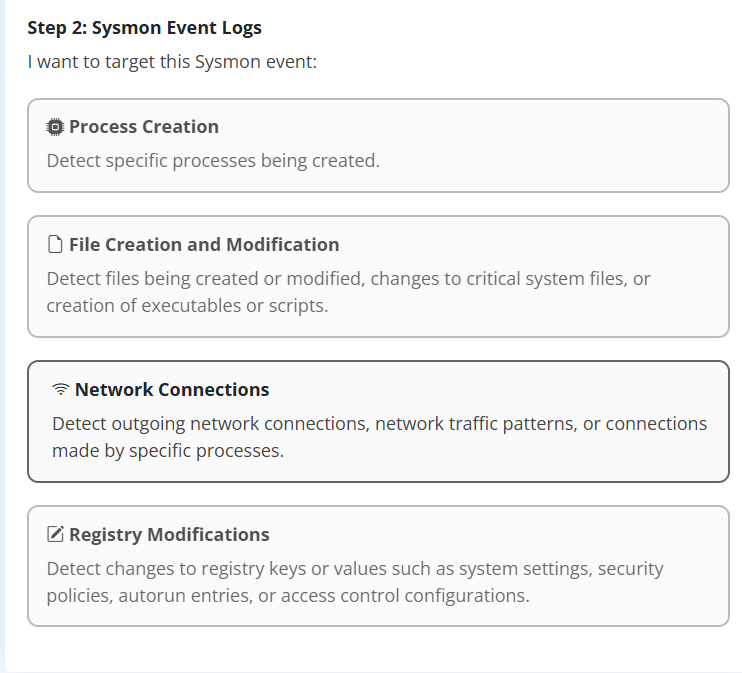

The different registry activity shown are: 

PID: 3806 - sample4.exe (This is a suspicious process shown over here)
PID: 1928 - explorer.exe
PID: 9876 - notepad.exe

- **(PID) Process:** (3806) sample4.exe	
- **Key:** HKEY_LOCAL_MACHINE\SOFTWARE\Microsoft\Windows Defender\Real-Time Protection
- **Operation write	Name:** DisableRealtimeMonitoring
- **Value:** 1

We have to add the type of attack too, in this case which refers to: https://attack.mitre.org/tactics/TA0005/

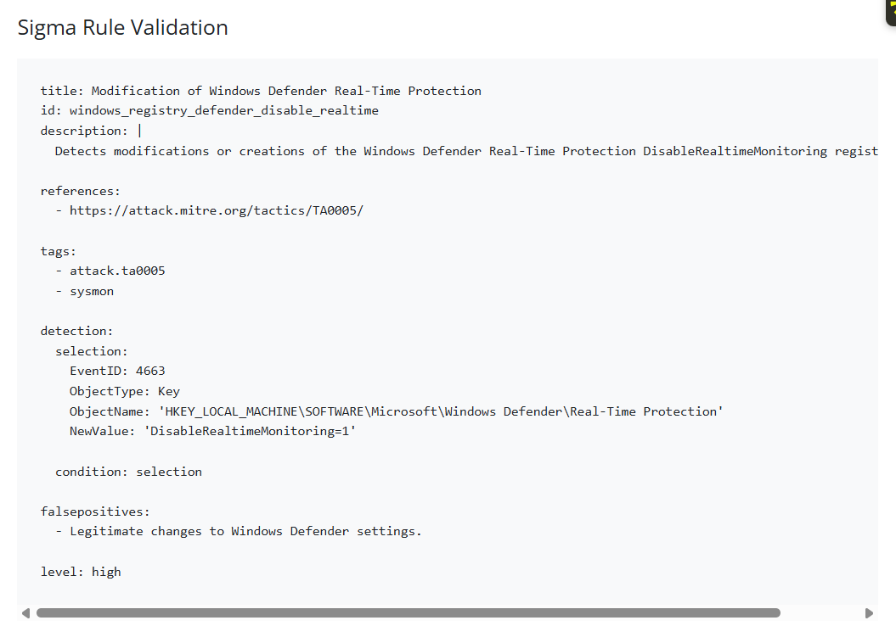

**Flag 4:**  THM{c956f455fc076aea829799c0876ee399}

### Challenge 5: The Red Team Frustration

<i>I'm not sure what you managed to do this time, but you seriously threw a wrench into my malware sample! I spent ages trying to reconfigure my attack tools and methodologies to get around your detection - SUPER ANNOYING!</i>

**Note from Red Team to Blue Team**

<i> I finally have sample5.exe for you to detect. Different approach this time. In this sample, all of the "heavy lifting" and instruction occurs on my back-end server, so I can easily change the types of protocols I use and the artifacts I leave on the host. You'll have to find something unique or abnormal about the behaviour of my tool to detect it.

I attached the logs of the outgoing network connections from the last 12 hours on the victim machine. That may help you correlate something. </i> 

**IOC:** sample5.exe

Well now the network activiity becomes like:  

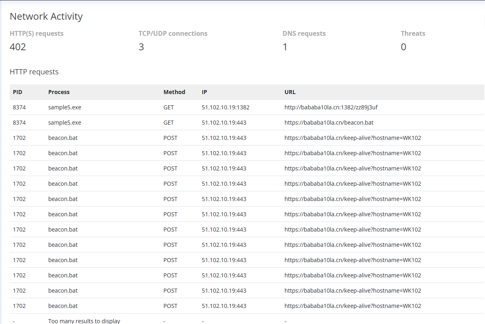

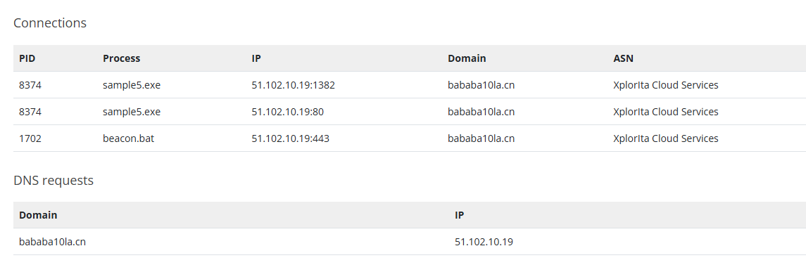

**IOA:** 

- sample5.exe 
- beacon.bat
- IP Address: 51.102.10.19:1382
- Domains: 
    - http://bababa10la.cn:1382/zz89j3uf
    - https://bababa10la.cn/beacon.bat
    - https://bababa10la.cn/keep-alive?hostname=WK102

We also have the outgoing connection logs mentioned:

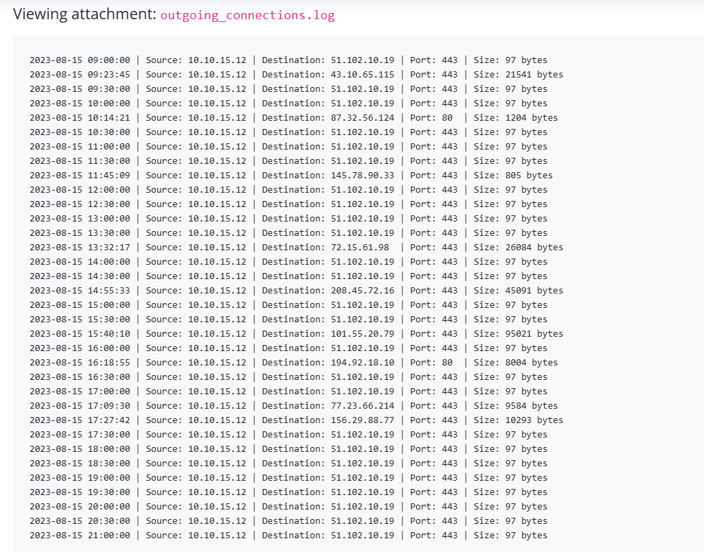

If we closely inspect the firewall logs and the file analysis details, the beacon.bat file creates, outbound connection.

**Destination IP:** 51.102.10.19:443
**Amount of data Transfer:** 97
**Time taken for each packet sent:** 1800

**Behavioral Analysis:**

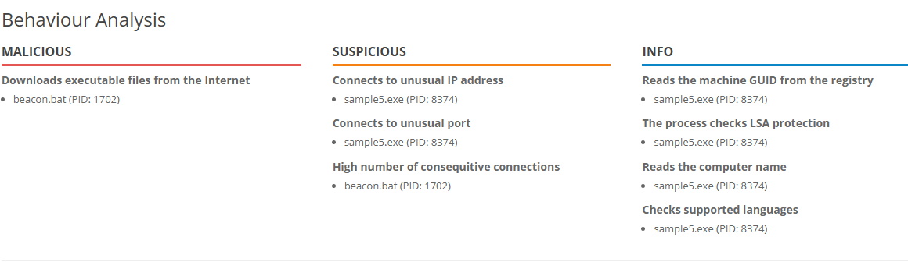

Lets create another sigma rule that helps to prevent the outbound connections to these suspicious IP address vai the relative port mentioned

While looking at the network connections logs we are able to see the time taken is 1800 s for each data transfer, and since the attacker is using multiple ports we filter out network connection rule as: 

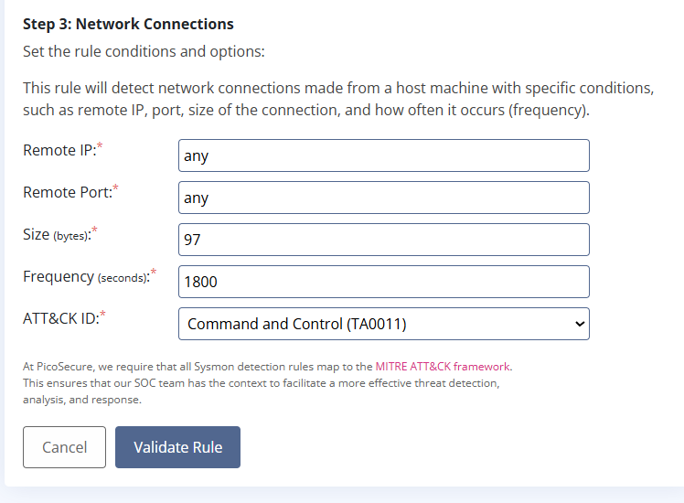

**Flag 5:** THM{46b21c4410e47dc5729ceadef0fc722e}

### Challenge 6: The Internal Test Assignment

**Note from Red team to Blue Team:** 
 <i> For my last trick, I have sample6.exe. This time, you will need more than artifacts or tool detection to help you. You'll need to focus on something extremely hard for me to change subconsciously - my techniques and procedures.

I've attached the recorded command logs from all my previous samples to understand better what actions I tend to perform on my victims to extract info once I have remote access. Good luck!</i> 

**IOC:** sample6.exe

**IOA:** 

- URL: http://contr0l2hax.info:1499/kwsx92la
- contr0l2hax.info | 	182.44.41.12:1499, 182.44.41.12:80, 182.44.41.12:443

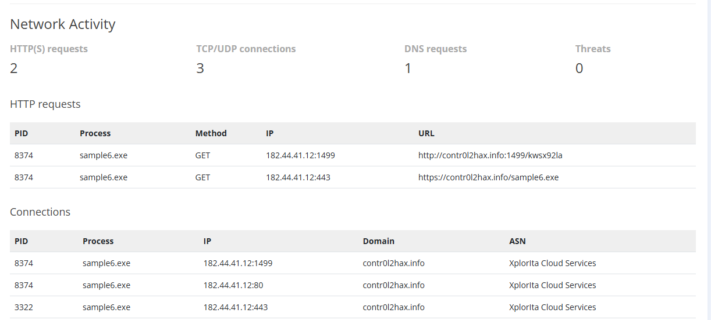
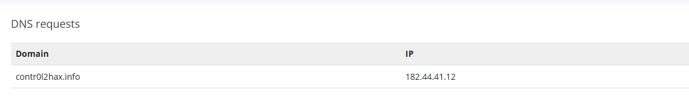

We also notice various process creation taking place:

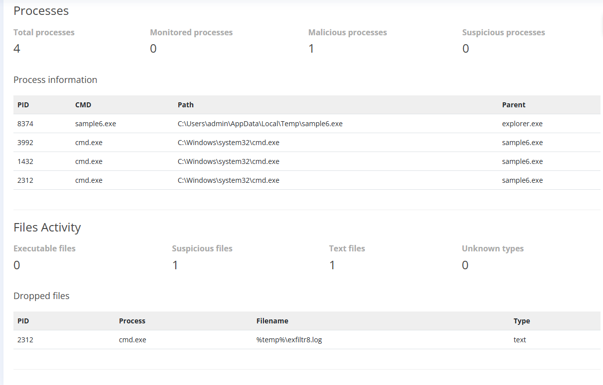

We can notice a process creation taking place: 

As per the logs also we are able to see that the red team intents to run the same command from cmd.exe

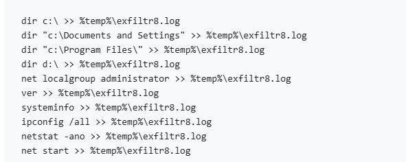

**Command:** 	%temp%\exfiltr8.log

The kind of attack is possibly a data exfiltration activity.

Lets create a sigma process creation rule: 

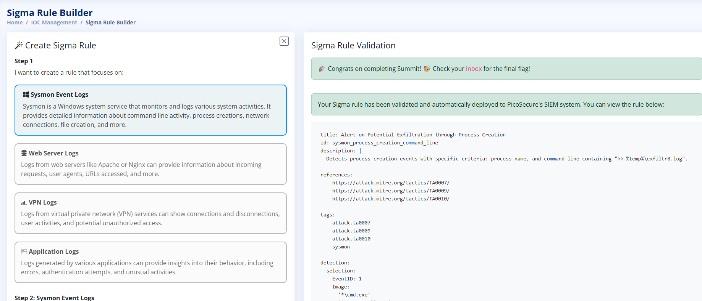

**Process name:** cmd.exe
**Contains**
**String/Command:** %temp%\exfiltr8.log
**MITRE Att&CK:** Data Exfiltration

**Flag 6:**  THM{c8951b2ad24bbcbac60c16cf2c83d92c}

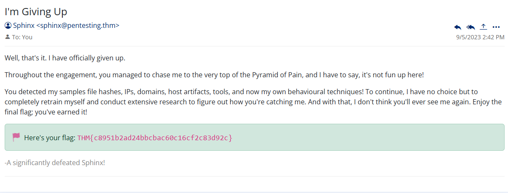

## Challenge Completion

I believe this is one of the most crucial topic and a challenge to be followed, if as a defender I can figure how to take preventive measures to proctect the enviornment with using Pyramid Of Pain as a baseline to prevent attackers from targeting us then this will be more than an amazing thing to do. 