# SYSMON Practical Investigation

This lab is about finding the right sysmon activity taking place which gets detected. The aim is to use sysmon and to use the rules to ensure that the detection is possible. 

## Common Sysmon Threat Hunting Event ID

We will use this table as a reference. 

| Event ID              | Activity Name            | What It Tracks                                                                    |
|-----------------------|--------------------------|-----------------------------------------------------------------------------------|
| Event ID 1            | Process Creation         | Full command line arguments, parent-child process relationships, and file hashes. |
| Event ID 2            | File Create Time Changed | Modifications to a file's original creation timestamp.                            |
| Event ID 3            | Network Connection       | TCP/UDP connections mapped directly to the executable that made them.             |
| Event ID 5            | Process Terminated       | The exact time a process stops running.                                           |
| Event ID 8            | CreateRemoteThread       | One process injecting an execution thread into another process's memory space.    |
| Event ID 10           | ProcessAccess            | A process opening a handle to read or write to another process.                   |
| Event ID 11           | FileCreate               | The exact moment a new file is dropped onto the hard drive.                       |
| Event ID 12 / 13 / 14 | Registry Events          | Creation, modification, deletion, or renaming of Windows Registry keys/values.    |
| Event ID 16           | Sysmon Config Changed    | Updates or modifications made to the active Sysmon XML configuration file.        |
| Event ID 22           | DNS Query                | Every domain name lookup requested by a process, even if it fails.                |
| Event ID 25           | Process Tampering        | Advanced modifications to a process image in memory.                              |

--------

## Investigation Scenarios

### Investigation 1 - ugh, BILL THAT'S THE WRONG USB!

**Scenario-1:** In this investigation, your team has received reports that a malicious file was dropped onto a host by a malicious USB. They have pulled the logs suspected and have tasked you with running the investigation for it.

**Logs Location in lab:** C:\Users\THM-Analyst\Desktop\Scenarios\Investigations\Investigation-1.evtx

Since I have downloaded the file I will run the challenge locally.

**Question 1:**  What is the full registry key of the USB device calling svchost.exe in Investigation 1? 

**Answer:** 

**Approach:** 

Number of events: 11

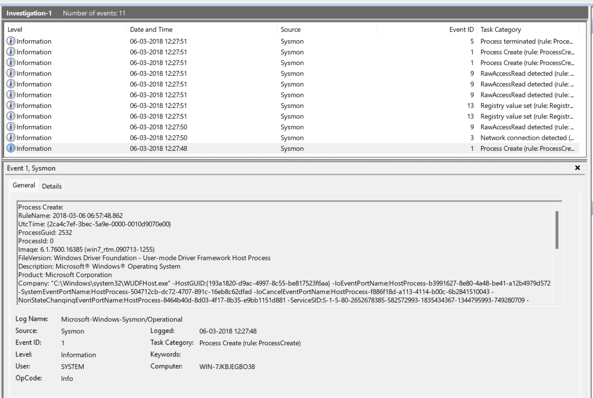

We will start from bottom duh going in the right order of timeline.

Sysmon doesnt have anything with related to USB Key insertion, but then there can be a workaround for this, what happens is if a new hardware USB is inserted, then the scenario becomes like, we can refer to Event ID 12/13 from the Registry Monitoring.

Actual path for USB: Computer\HKEY_LOCAL_MACHINE\SYSTEM\CurrentControlSet\Services\USBSTOR

But in this case it doesnt exist, hence we focus on the process creation and the Registry Activity.

Lets focus on the question so we check the first event id 13 alert and the respective registry key creation: 

As we will see the below image doesnt get called by the svchost.exe:

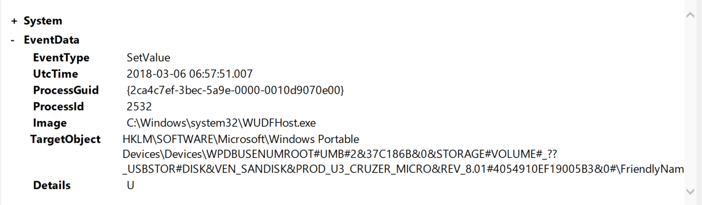

Now we move on to the next alert to see the details:

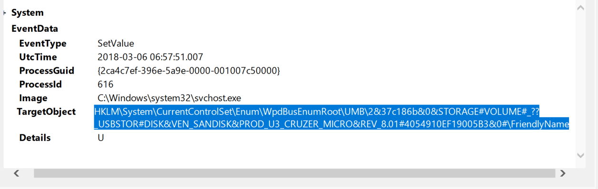

So inspecting closely we see number of various activity taking place: 
- RawAccessRead
- Process Creation to the USBSTOR
- Vendor: SanDisk
- It opens notepad, runs calc.exe etc...

**Question 2** - What is the image file generated by the ReadAccessRun

**Answer:** \Device\HarddiskVolume3

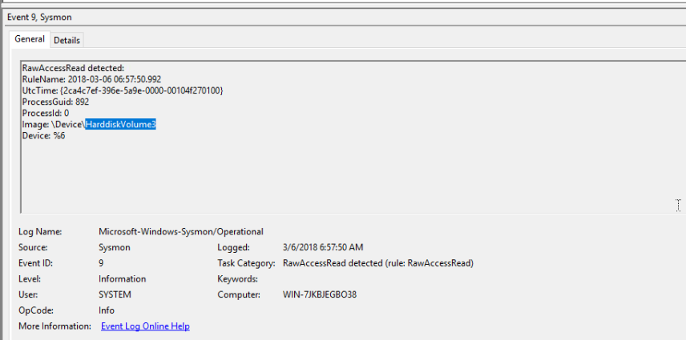

**Question 3** What is the first exe that runs?

**Answer:** rundll32.exe

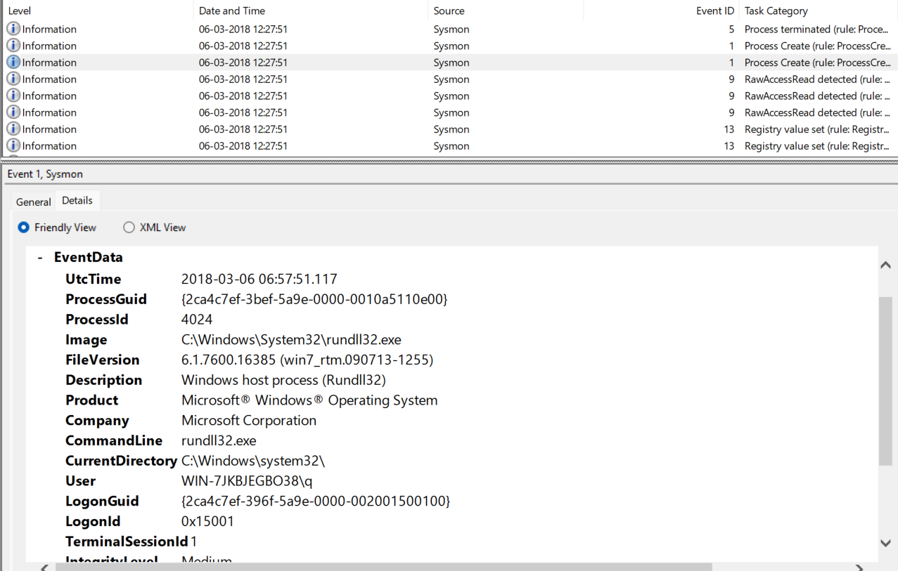

### Investigation 2 - This isn't an HTML file? 

Another suspicious file has appeared in your logs and has managed to execute code masking itself as an HTML file, evading your anti-virus detections. Open the logs and investigate the suspicious file. 

**Question 3:** What is the full path of the payload in Investigation 2?

**Answer:** C:\Users\IEUser\AppData\Local\Microsoft\Windows\Temporary Internet Files\Content.IE5\S97WTYG7\update.hta

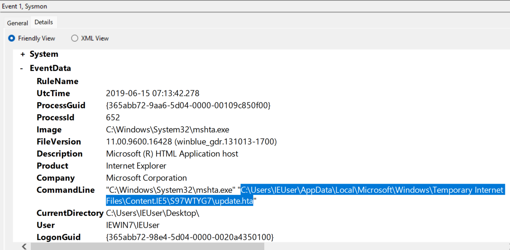

**Approach:** 

Number of Events: 3

If suspicious process ran so best way to filter by event ID 3.

open the first suspicious process and voilaa

**Question 4:** What is the full path of the file the payload masked itself as in Investigation 2?

**Answer:** We have to see the file masked as a legitmate service so...

C: C:\Windows\System32\mshta.exe 

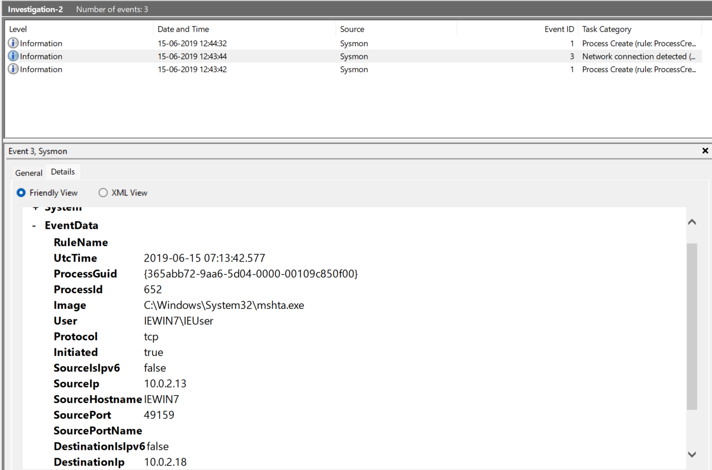

This is due to we see the initiated as true. This image help us answer the next question.

**Question 5:** What is the IP of the adversary in Investigation 2?

**Answer:** 10.0.2.18

**Question 6:** What back connect port is used in Investigation 2?

**Answer:** 4443

### Investigation 3 - Investigation 3.1 - 3.2 - Where's the bouncer when you need him

Your team has informed you that the adversary has managed to set up persistence on your endpoints as they continue to move throughout your network. Find how the adversary managed to gain persistence using logs provided.

**File used:** Investigation 3.1

**Question 7:** What is the IP of the suspected adversary in Investigation 3.1? 

**Answer:** 172.30.1.253

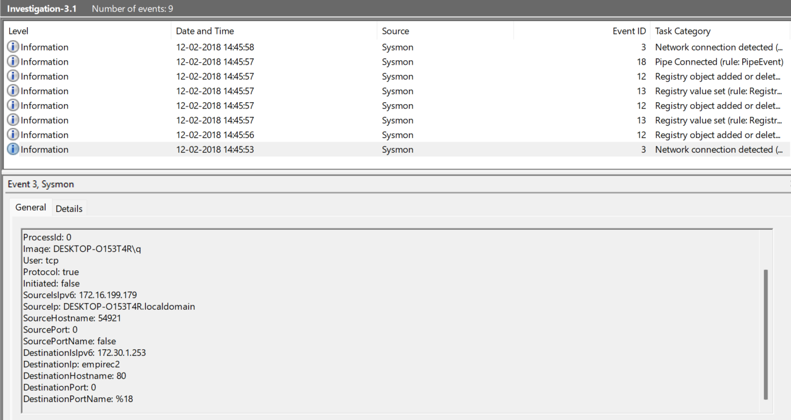

**Question 8:** What is the hostname of the affected endpoint in Investigation 3.1?

**Answer:**  HKLM\SOFTWARE\Microsoft\Network\debug

We could see at event 12 the registry value was added and registry key 13 the value was set.

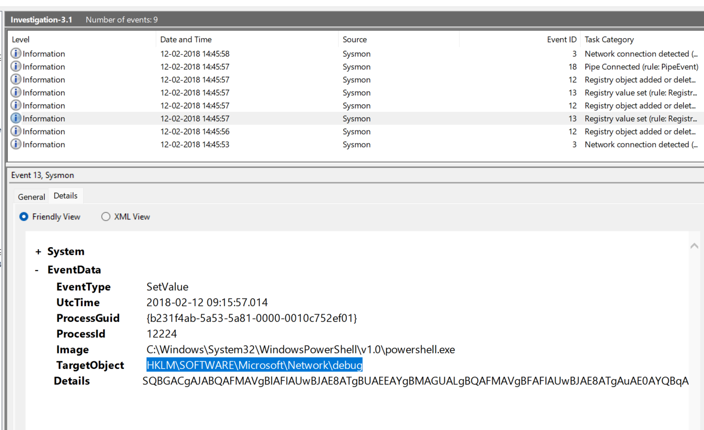

**Question 9:** What PowerShell launch code was used to launch the payload in Investigation 3.1?

**Answer:** C:\Windows\System32\WindowsPowerShell\v1.0\powershell.exe" -c "$x=$((gp HKLM:Software\Microsoft\Network debug).debug);start -Win Hidden -A \"-enc $x\" powershell";exit

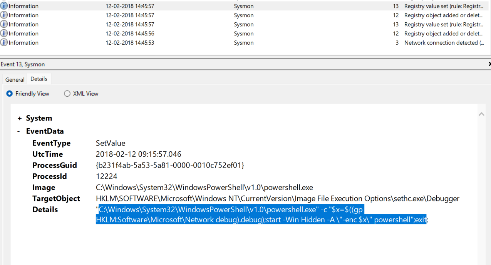

**File used:** Investigation 3.2

**Question 10:** What is the IP of the suspected adversary in Investigation 3.1? 

**Answer:** 172.168.103.188

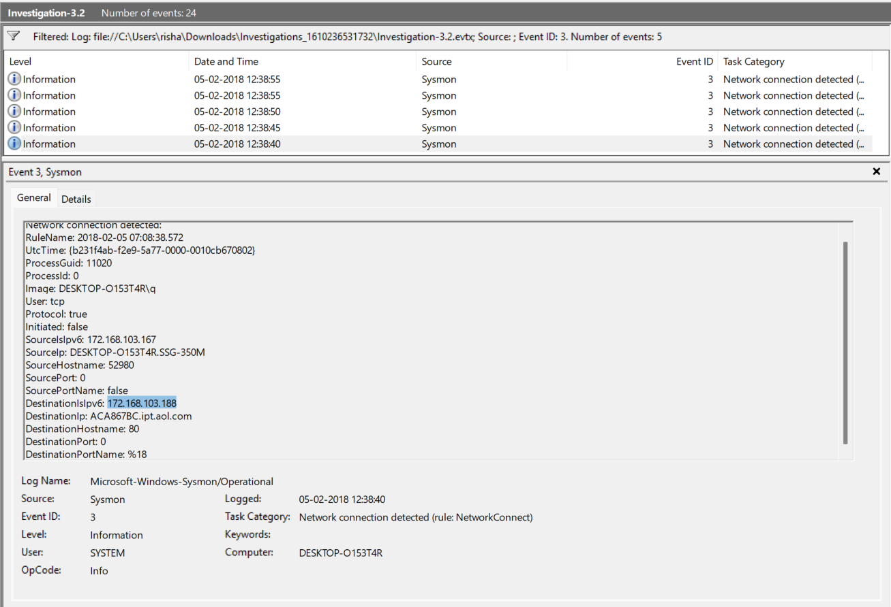

**Question 11:** What is the full path of the payload location in Investigation 3.2?

**Answer:** c:\users\q\AppData:blah.txt

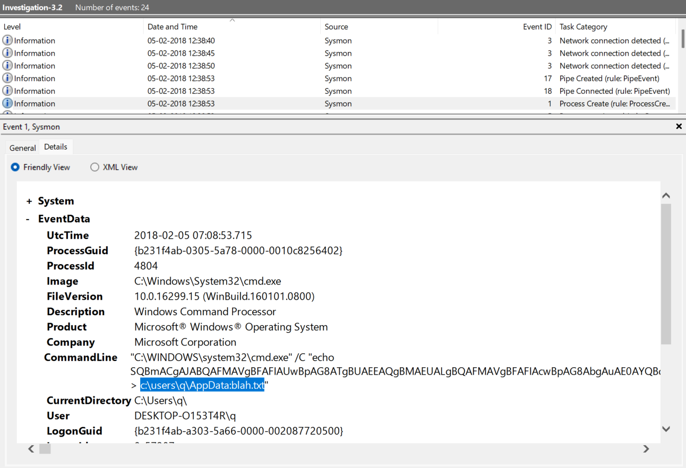

**Question 12:** What was the full command to create and save this payload to the location?

**Answer:** Too big and tideous to display just filter it and you will be able to find it.

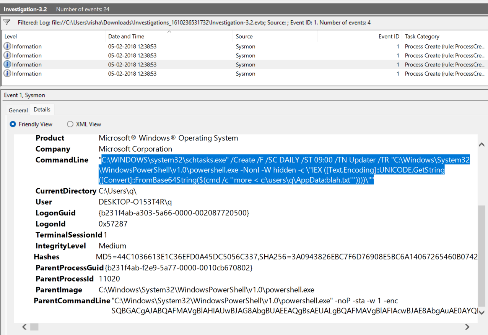

**Question 13:** What process was accessed by schtasks.exe that would be considered suspicious behavior in Investigation 3.2?

**Answer:** lsass.exe

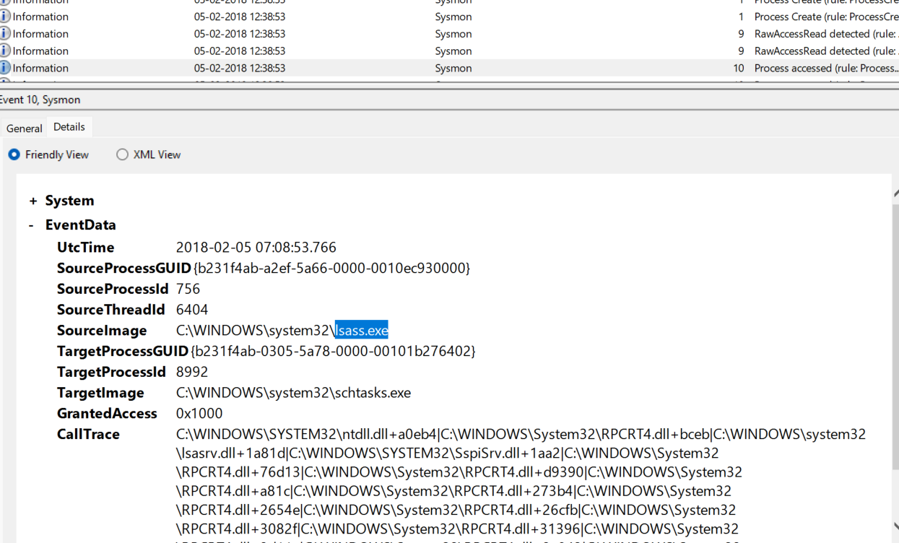

###  Investigation 4 - Mom look! I built a botnet!

As the adversary has gained a solid foothold onto your network it has been brought to your attention that they may have been able to set up C2 communications on some of the endpoints. Collect the logs and continue your investigation.

Number of Events: 13

File Name: Investigation4.evtx

**Question 14:** What is the IP of the adversary in Investigation 4?

**Answer:** 172.30.1.253

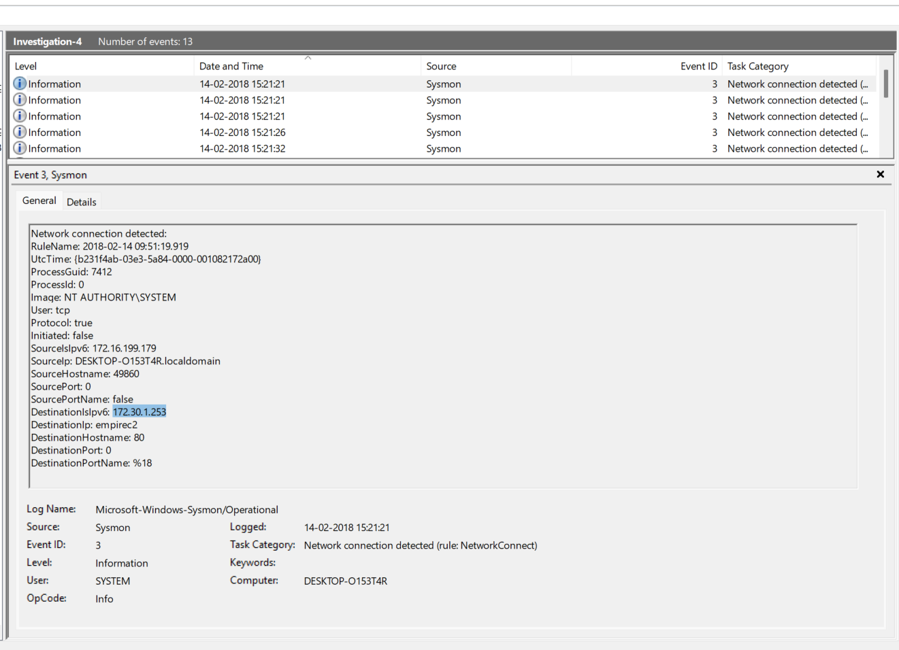

**Question 15:** Destination Port Name?
**Answer:** 80

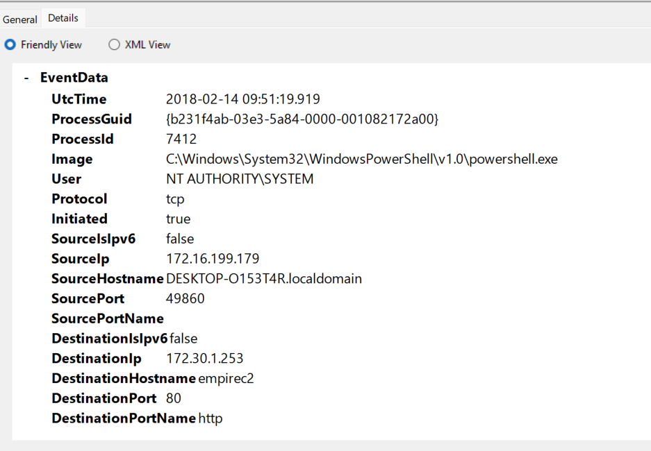

-----

## Learnings from Lab:

There are already many pre configured rules which are written and saved, but the point Hunting is not an easy task. One thing what sysmon teaches is, **It is not about including it is mostly about excluding**. Excluding helps us cut the noise, and help to catch real results which we want to note as a SOC analyst or as a Threat Hunter. 

I feel this was a learning from a SOC L2 POV or rather a Threat Hunter POV. This room taught me many things, from what to find, and what to note, and as an analyst, analyzing events is just as important to analyze logs. From an endpoint perspective these are crucial and can be used to filter more telemetry data.